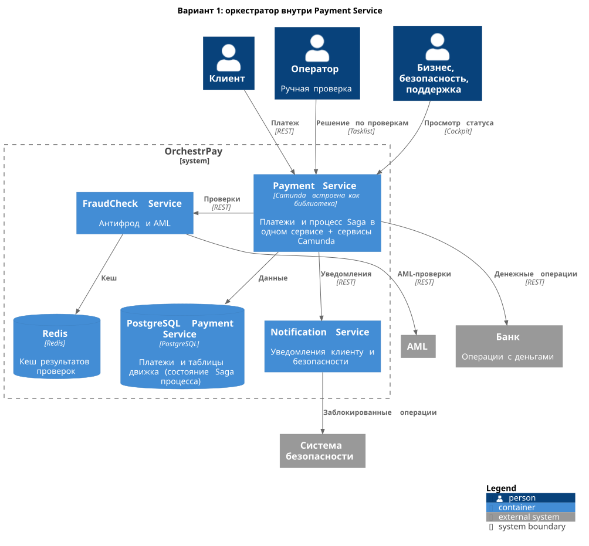
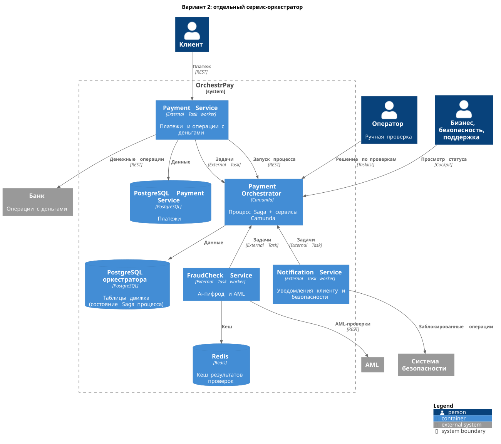

# ADR: Где разместить оркестратор платежной Saga

## Общая информация

1. Родительский артефакт - [реестр транзакций](../Task1/transactions.md) и [таблица переходов](../Task2/transitions.md)
2. Автор ADR - Андрей Чигиринский
3. Статус - Принят
4. Согласующие - Платежные сервисы, Безопасность, Финансы, DevOps/SRE

## Контекст

OrchestrPay проводит платежи через Saga-оркестрацию на движке Camunda.
Нужно решить, где работает оркестратор: внутри Payment Service или отдельным сервисом.

Что влияет на выбор:
- В процессе участвуют Payment, FraudCheck и Notification сервисы, внешняя AML-проверка.
- Процесс по смыслу принадлежит Платежным сервисам (владелец процесса).
- Процесс сильно ветвится: ~30 переходов state machine, три итоговых состояния. Есть компенсации до точки невозврата и корректировка после нее.
- Есть ручной шаг: оператор принимает решение за ограниченное время.
- Бизнес и безопасность должны видеть, где застряла транзакция, финансам нужен аудит денежных операций.
- Успешный платеж должен проходить быстрее 5 секунд в 90% случаев.

## Рассмотренные варианты

### Вариант №1 "Оркестратор внутри Payment Service"

[option1.puml](option1.puml)

Camunda встроена в Payment Service как библиотека, таблицы движка лежат в его PostgreSQL рядом с платежами. Создание и финализация платежа - локальные вызовы, к FraudCheck Service (антифрод и AML), банку и Notification Service движок ходит по сети. Задачу оператора ведет тот же движок, процессы смотрят в Cockpit внутри Payment Service.

### Вариант №2 "Отдельный сервис-оркестратор"

[option2.puml](option2.puml)

Payment Orchestrator - отдельный сервис команды Платежных сервисов с Camunda и своей PostgreSQL, где хранится состояние Saga.

1. Клиент создает платеж через API Payment Service, тот запускает процесс в оркестраторе.
2. Каждый шаг из реестра - External Task: движок ставит задачу, worker в Payment Service (платеж, холд, списание, перевод, возврат), FraudCheck Service (антифрод и AML) или Notification Service забирает ее, выполняет и отчитывается. Движок отвечает за ретраи, таймауты и cut-off автоматических проверок.
3. Результаты проверок кешируются в Redis, чтобы повторный шаг не ходил во внешние системы заново.
4. Ручная проверка - User Task в Camunda Tasklist, на нее ставится таймер на 20 минут.
5. Бизнес, безопасность и поддержка смотрят состояние платежей в Cockpit.

Оркестратор ведет только процессы платежного домена и не становится общей шиной для всей компании.

## Сравнение альтернатив

| Вариант решения | Преимущества | Недостатки |
| :- | :- | :- |
| Вариант №1 "Оркестратор внутри Payment Service" | - Меньше сервисов, деплоев и баз - Меньше сетевых переходов: создание и финализация платежа без сети | - Платежная логика и процесс в одном коде - Любая правка процесса требует релиза Payment Service и участия его команды - Процесс не переиспользовать в других доменах и продуктах - Нагрузка или неудачный релиз Payment Service тормозят все выполняющиеся процессы - Чтобы видеть процессы, безопасности и поддержке нужен доступ к Payment Service |
| Вариант №2 "Отдельный сервис-оркестратор" | - Сервисы отвечают только за доменную работу, а оркестратор за процесс - Процесс меняется независимо от Payment Service - Состояние всех платежей в одном месте: Cockpit для бизнеса и безопасности, история для аудита - Свои масштабируемые ресурсы и релизы: проблемы Payment Service не тормозят движок - Движок можно использовать для других процессов платформы | - Еще один сервис и база, за которые отвечает эксплуатация - Платеж проходит, только если работают и Payment Service, и оркестратор - Дополнительные сетевые переходы |

## Принятое решение

Вариант №2 "Отдельный сервис-оркестратор".

Отдельный оркестратор оправдан, когда процесс затрагивает много сервисов, сильно ветвится, включает ручные шаги, требует аудита и наблюдения за прогрессом и под него есть готовый движок. Платежный процесс OrchestrPay подходит под все эти условия: в нем участвуют три сервиса и внешние системы, около 30 переходов state machine, решение оператора, требования бизнеса, безопасности и финансов видеть каждый платеж, а Camunda уже выбрана платформой.

Встраивание в доменный сервис хорошо для короткого линейного процесса, который редко меняется и требует минимальной задержки. Наш процесс не линейный, а выигрыш в задержке мал (сетевой переход внутри кластера занимает миллисекунды), тогда как почти все 5 секунд уходят на проверки и банк.
